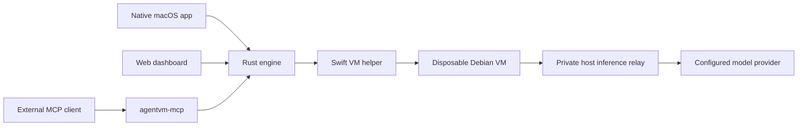

<div align="center">

<picture>
  <source media="(prefers-color-scheme: dark)" srcset="docs/assets/logo-dark.svg">
  
</picture>

# agentvm

**Every terminal is a sealed machine.**

Run coding agents in disposable Debian VMs on your Mac.
Control them from the native app, dashboard, API or MCP.

[](https://github.com/egeominotti/agentvm/actions/workflows/ci.yml)


[Quickstart](#quickstart) · [CLIs](#coding-clis) · [MCP](#external-control-with-mcp) · [Releases](https://github.com/egeominotti/agentvm/releases/latest)

</div>

Each agent gets its own Debian 13 VM through Apple's Virtualization.framework.
It runs as root on a fresh checkout, with permission to install packages, run
servers and edit code. Your original checkout stays on the Mac. Save brings the
work back as commits on an `agent/<id>` branch.

The SwiftUI macOS app and web dashboard share one Rust engine. VMs survive engine
restarts, app exits and MCP disconnects. Terminals use persistent tmux sessions,
so reconnecting keeps the conversation and shell state.

## Quickstart

For Apple Silicon Macs running macOS 14 or newer:

1. [Download the DMG](https://github.com/egeominotti/agentvm/releases/download/v0.2.2/agentvm-native-v0.2.2-macos-arm64.dmg).
2. Open it and drag **agentvm Native.app** to **Applications**.
3. Eject the disk image and open **agentvm Native** from Applications.

Or install the app with [Homebrew](https://github.com/egeominotti/homebrew-tap):

```bash
brew install --cask egeominotti/tap/agentvm
```

On first launch, if the VM image is missing, open **Settings → VM image**, click
**Rebuild image** and wait for **Ready**. This prepares Debian once; later
launches reuse the image.

Connect an account in **Settings → Agent accounts** (**Claude account** for
Claude Code), or add an API provider in **Settings → Providers**.
Press **New VM**, choose a repository, coding CLI and account or provider, then
click **Launch VM**. Models are selected automatically.

[Releases](https://github.com/egeominotti/agentvm/releases/latest) also includes
the native ZIP and a CLI archive with prebuilt binaries. Release builds are
ad-hoc signed and are not notarized with an Apple Developer certificate.
See [native app operations](macos/OPERATIONS.md).

### From source

```bash
git clone https://github.com/egeominotti/agentvm.git
cd agentvm
./quickstart
```

It builds what changed, prepares the VM image once, starts the engine and opens
the dashboard at `http://127.0.0.1:7777`.

Source builds require Xcode Command Line Tools, [Rust](https://rustup.rs) and
[Bun](https://bun.sh). The first image preparation downloads Debian and installs
guest tools; later launches reuse the image.
Only the selected additional CLI is downloaded into each disposable disk.

## Coding CLIs

| CLI | Account access | API provider support |
| --- | --- | --- |
| Claude Code | Claude subscription | Anthropic-compatible |
| Codex | ChatGPT | OpenAI Responses |
| Gemini CLI | Google Code Assist | Google Gemini |
| OpenCode V1 | ChatGPT | OpenAI, Anthropic, Google |
| Qwen Code | Subscription keys through providers | OpenAI, Anthropic |
| GitHub Copilot CLI | GitHub Copilot | OpenAI or Anthropic BYOK |
| Kilo CLI | Kilo account/credits, ChatGPT | OpenAI, Anthropic, Google |
| Aider | Subscription keys through providers | OpenAI, Anthropic, Google |
| Goose | Claude, ChatGPT | OpenAI Chat Completions |
| Custom CLI | Your commands and selected provider | Compatible endpoint or no credential |

In **Settings → Accounts**, connect ChatGPT, Google, GitHub Copilot or Kilo using
browser sign-in or an existing host CLI login where offered. Claude uses the
existing `claude setup-token` flow. Account credentials remain on the Mac.
Access and limits depend on the connected account's plan and organization.

Provider presets include OpenAI, Anthropic, Google, OpenRouter, local servers,
custom endpoints, **Alibaba Coding Plan**, **OpenCode Go/Go Plus** and **OpenCode
Zen**. A subscription can use a provider key: Go and Coding Plan use monthly-plan
keys, while Zen uses usage billing. Choose the matching preset and credential.
See [OpenCode Go](https://opencode.ai/v2/docs/console/go/) and
[Qwen authentication](https://qwenlm.github.io/qwen-code-docs/en/users/configuration/auth/).

CLIs use their native defaults where suitable; other integrations select a model
from the compatible provider catalog. Local providers need an installed chat
model. API and MCP callers can optionally override the model.
See [CLI support and installation recipes](docs/cli-support.md).

## Working in a VM

Choose a local git repository or remote URL. Private repositories use the Mac's
git access or a per-host token from Settings. Each VM receives a bundle and works
in `/root/work`; your Mac checkout is not mounted into it.

- **Terminals:** the selected agent plus up to nine root shells, clipboard,
  uploads, Ghostty/restty rendering and xterm fallback.
- **Save:** import committed work into the VM's branch while it keeps running.
- **Close:** save and shut down. A failed save keeps the VM available.
- **Push:** push its branch to the repository remote.
- **Snapshots:** capture, restore, export, import and back up VM state to S3.
  Disks are compressed and deduplicated; snapshots can run on a schedule.
- **Services:** guest ports get names such as `http://3000.<vm>.localhost:7777`;
  every VM can use port 3000 independently.
- **Tailscale:** join a VM to your tailnet for SSH and remote services.
- **Telemetry:** CPU, memory, disk, network, processes, boot steps and diagnostics.
  Automatic output stays available after completion. Claude tasks also have
  conversation, token and cost views.

Repository setup can live in `.agentvm/setup.sh`. It runs inside the VM before the
agent starts. Dependencies and build output are excluded from automatic commits.
The guest includes zsh, starship, git tools, Chromium and Playwright MCP.

## External control with MCP

The native `agentvm-mcp` binary exposes **43 tools** over stdio using the official
Rust MCP SDK. It controls the existing engine without starting another VM
supervisor. The native app's Settings provides a copyable configuration.

```json
{
  "mcpServers": {
    "agentvm": {
      "command": "/absolute/path/to/agentvm/bin/agentvm-mcp"
    }
  }
}
```

Tools cover tasks, launch/save/close/stop, settings, credentials, snapshots,
backups, storage, diagnostics, telemetry, output, processes, files and terminals.
Literal argv and explicit Bash scripts are separate operations. Process output
is bounded; binary files use chunked base64. Artifact transfers stream through
host file paths.

Connect from another computer using authenticated SSH stdio. The engine stays on
loopback. See [MCP setup, examples and limits](docs/mcp.md) and the
[JSON API reference](server/src/mcp/reference.txt).
New VMs include structured control; older running guests need a new launch or
snapshot restore to receive it.

## Architecture and credentials



Inference credentials stay on the host. New guests receive dummy credentials and
a loopback endpoint; requests cross vsock to a private per-VM relay, which adds
the selected host credential. This also reaches model servers bound to the Mac's
loopback interface. Git and S3 credentials remain on the Mac. An optional
Tailscale join key reaches its guest once and is then deleted.

The engine and forwarded services listen on loopback. Each VM sees only its own
job folder. Host reads reject guest symlinks and FIFOs. Older snapshots may contain
credentials from previous runtimes; restore snapshots from sources you trust.
See [Security](SECURITY.md).

## Development

```bash
scripts/build.sh             # Incremental engine, helper, dashboard and MCP
scripts/test.sh              # Rust, dashboard and guest tests
macos/test.sh                # Native Swift, terminal and packaging tests
macos/build.sh               # Native app and ZIP
```

Real VM tests run separately with `scripts/test.sh --ignored`; some use provider
quota or S3. Run relevant cases while developing. Use `scripts/sandbox.sh` for UI
checks against an isolated engine, preserving the user's running VMs.

```text
server/     Rust domain, use cases, HTTP, adapters and native MCP
web/        React + TypeScript dashboard, built with Bun
macos/      SwiftUI/AppKit app and bundled terminal renderer
vm-helper/  Virtualization.framework VM process and vsock bridges
guest/      CLI runners, installer, relay and structured control
scripts/    Build, tests, golden image and isolated development tools
```

Read [AGENTS.md](AGENTS.md) and [CONTRIBUTING.md](CONTRIBUTING.md) for repository
rules. Release changes are in [CHANGELOG.md](CHANGELOG.md).

## License

[MIT](LICENSE).
